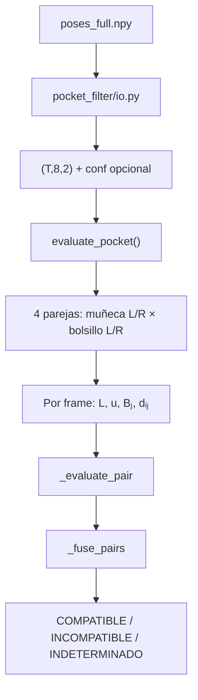

# Afinar `hand_to_body` / aproximación a bolsillo — estudio y opciones de implementación

**Audiencia:** agente de implementación, calibración y optimización (handoff a agente potente).  
**Alcance:** diseño, comparación de soluciones, **estado de la implementación prototipo nov 2026**, y preguntas abiertas.  
**Última actualización del handoff:** 2026-03-20 (tras primer prototipo `pocket_filter` + `har2_test.py`).  
**Fuentes:**

- Spec: `KANVIS_Filtro_Ignacio_Especificacion.docx` (v1.0, filtro determinista de trayectorias hacia el bolsillo).
- Código actual: `har/har_actions/detect.py` → `_hand_to_body`.
- Prototipo nuevo: `har/pocket_filter/` + `har/har2_test.py`.
- Integración Kanvis: Orchestrator (`har_premodel`, `har_robbery_review`, `har_sam3_gate`) y contrato de poses C1 (`poses_full.npy` 8 KP, COCO 5–12).

---

## 0. Contexto de producto Kanvis (lectura obligatoria)

> **Este documento va dirigido a otro agente.** Lee primero esta sección entera, luego el resto, y **responde siguiendo la plantilla de la sección 14** (respuesta muy estructurada, sin improvisar el formato).

### 0.1 Qué es Kanvis

**Kanvis** es un **sistema de detección de hurtos en retail** (supermercados / pasillos). Objetivo de negocio: identificar comportamientos de **ocultación o manipulación sospechosa** en vídeo de cámara fija, con el mínimo de **falsas alarmas** que puedan desgastar operación en tienda o a los clientes.

No es un proyecto académico de HAR de pasillo: es **capa heurística de apoyo** a un pipeline de producción que ya incluye modelos entrenados con **miles de clips** y despliegue en tienda.

### 0.2 Qué ve el sistema (datos)

| Capa | Qué produce |
|------|-------------|
| **C1 / Monitoring** | Personas en cámara, tracks, chunks de vídeo, esqueleto **8 keypoints** (hombros, codos, muñecas, caderas; COCO 5–12), export `poses_full.npy` |
| **C2 / Motion (IAModel)** | Scores de robo (p41, p48, ensembles, etc.) por chunk |
| **C3 / Orchestrator** | Decide candidatos, encadena **HAR**, **SAM3** (segmentación/objeto), política de aviso y revisión humana |

Coordenadas del esqueleto: normalizadas (0–1), **eje Y hacia abajo**. Puntos no vistos = `NaN`. En Kanvis es frecuente `(T, 8, 3)` con confianza por keypoint.

Este repo **HAR_v2** no entrena el modelo de robo: **analiza el esqueleto** para marcar **gestos interpretables** (caminar, parar, llevar algo, **acercar la mano al cuerpo**, etc.).

### 0.3 El problema que estamos resolviendo

El **modelo de hurtos** sigue disparando **falsos positivos (FP)** en acciones **cotidianas** del pasillo:

- Pasear y balancear los brazos.
- Parar a mirar el lineal sin coger producto.
- Caminar con producto en la mano de forma visible (llevar al pecho, cesta, etc.).
- Gestos breves (mano arriba, ajustarse la ropa) que el motion interpreta como patrón de robo.

**Coste del FP:** alarmas innecesarias, revisión humana, posible escala a SAM/VLM, pérdida de confianza del sistema.

**Hipótesis del equipo (no dogma, pero guía el diseño):**

> Un hurto con ocultación visible suele incluir una **cinemática de aproximación de la mano hacia el cuerpo** (bolsillo lateral, fajo del pantalón, pecho/chaqueta en casos avanzados).  
> Si el modelo de robo dispara **y no hay evidencia fiable de esa cinemática**, el caso es candidato a **falso positivo** (o al menos **no debe escalarse** como alerta fuerte).

**Precaución crítica:** “no se vio la mano” (oclusión, cámara lateral, pose mala) **no es** lo mismo que “manos lejos del cuerpo”. Por eso el contrato de Ignacio tiene **tres estados**, no un sí/no binario.

### 0.4 Qué entendemos por “acciones raras” o sospechosas (en este proyecto)

No clasificamos “raro” por estadística de la tienda, sino por **patrones geométricos del esqueleto** ligados a ocultación:

| Acción / patrón | Relevancia hurtos | Estado en el código |
|-----------------|-------------------|---------------------|
| **Aproximación mano → bolsillo / cuerpo** (`hand_to_body` mejorado) | **Central** — filtro FP y refuerzo de candidato | Prototipo `pocket_filter` |
| Llevar mano estable mientras camina (`carry`) | Puede ser bolsa legal o producto; sospecha moderada | HAR pasillo legacy |
| Mano arriba breve (`hand_up`) | A veces cotidiano; a veces gesticulación antes de ocultar | HAR pasillo legacy |
| Walk / stop / turn / arm_swing | **Cotidianos** — ayudan a **explicar** FP | HAR pasillo |
| Mano a pecho, bajo abrigo, mochila | Hipótesis alternativas (v2+) | Fuera de v1 bolsillo |

**Enfoque actual v1:** afinar **muy bien** la señal “**mano que se acerca al cuerpo hacia zona de bolsillo**” con **trayectoria temporal** (lejos → cerca), no solo “mano cerca de la cadera un instante”.

**No es objetivo v1:** detectar el **objeto** robado en píxeles (eso es SAM/VLM). Es objetivo v1: **¿hubo gesto de acercar mano al cuerpo/bolsillo con evidencia en el esqueleto?**

### 0.5 Cadena de decisión deseada (visión)

```text
Persona en pasillo
    → esqueleto en tiempo real
    → modelo motion: ¿candidato a hurto?
            SI
                → FILTRO geométrico (este trabajo)
                      COMPATIBLE   → conservar alerta / seguir SAM3
                      INDETERMINADO → conservar alerta; explicar incertidumbre
                      INCOMPATIBLE  → candidato FP (solo si política ON y sin otras hipótesis)
            NO
                → (HAR cotidiano puede adelantar skip de C2 en algunos pipelines)
```

El prototipo **`har2_test.py`** prueba el filtro **offline** con un `poses_full.npy`:

- `hand_to_body: sí` = **COMPATIBLE** (aproximación observada).
- Filtrar FPs de forma **segura** en producción = mirar **INCOMPATIBLE**, no el simple “no”.

### 0.6 Por qué este documento y este repo

- **Spec Ignacio** (`KANVIS_Filtro_Ignacio_Especificacion.docx`): contrato determinista muñeca → bolsillo.
- **HAND_TO_BODY_SOLUCIONES.md**: estudio, opciones, estado del prototipo, brechas, handoff.
- **Código:** `har/pocket_filter/` + CLI `har/har2_test.py` (separado del clasificador de pasillo c0/c1/c5).

Kanvis ya consume un gesto llamado `hand_to_body` en Orchestrator; el legacy en `detect.py` es **demasiado laxo**. Aquí se busca reemplazar o complementar esa señal con algo **defendible en revisión de vídeo**.

### 0.7 Criterios de éxito (producto)

| Criterio | Descripción |
|----------|-------------|
| **Recall de ocultación visible** | No perder hurtos donde la mano sí llega al bolsillo/cuerpo |
| **FP cotidianos filtrables** | En clips con motion+alarma pero gesto cotidiano, poder declarar **INCOMPATIBLE** cuando la pose lo permita |
| **Prudencia** | Oclusión / lateral / chunk corto → **INDETERMINADO**, no FP automático |
| **Auditoría** | Misma entrada → misma salida; JSON con tiempos y distancias |
| **Operación** | Primero **modo observación** en Orchestrator; descarte automático solo tras calibración acordada |

---

## 0bis. Resumen del problema técnico (una frase)

Kanvis detecta hurtos con ML; necesitamos un **módulo geométrico** que identifique **muy bien** si hubo **acercamiento de la mano al cuerpo (bolsillo)** en el esqueleto, para **bajar falsas alarmas** sin confundir “no visto” con “no ocurrió”.

Eso exige un detector de “mano al cuerpo / hacia bolsillo” con:

| Propiedad | Por qué |
|-----------|---------|
| **Alta sensibilidad a aproximaciones reales** | No perder robos verdaderos al filtrar |
| **Capacidad de declarar lejanía con certeza** | Solo ahí se puede matar el FP |
| **Abstención explícita (indeterminado)** | Oclusión, vista lateral, huecos de pose, identidad dudosa → **no descartar** |
| **Evidencia auditable** | Revisar en vídeo y reproducir el mismo resultado |

**Terminología (importante):**

| Nombre | Significado en este documento |
|--------|-------------------------------|
| `hand_to_body` | ID actual del gesto HAR pasillo (categoría 6 / sospecha) |
| Filtro Ignacio / pocket approach | Spec adjunta: trayectoria muñeca → bolsillo lateral |
| `hand_to_object` | En el mensaje de producto se usó como sinónimo informal de “mano lleva algo al cuerpo/bolsillo”; **no** es un detector de objeto en escena. La v1 es **geométrica sobre esqueleto**, no visión de producto. |

La mejora pedida no es “detectar el objeto robado”, sino **detectar muy bien la cinemática de ocultación hacia el cuerpo**, empezando por bolsillo lateral.

---

## 1. Qué hace hoy el código (baseline) y por qué no basta

### 1.1 Algoritmo actual (`_hand_to_body`)

Para cada frame, con brazos “ok”:

1. Marca `far` si la muñeca está ≥ **0,50 L** del eje hombro–cadera (`dist_axis`).
2. Marca `close` si la muñeca está ≤ **0,25 L** de su cadera (`dist_hip`).
3. Si hay ≥ **1 s** de frames `far` **y** ≥ **2 s** de frames `close` (pueden ser **brazos distintos** y **no ordenados en el tiempo**), emite un único segmento `hand_to_body` desde el primer `close` hasta el último `close`.

### 1.2 Fallos frente al objetivo Kanvis

| Debilidad | Efecto en FP / FN |
|-----------|-------------------|
| No exige **trayectoria** lejos → cerca | Un balanceo + una mano cerca de la cadera en otro momento → falso `hand_to_body` |
| No usa **mismo brazo / mismo lado** | Mezcla evidencia de dos manos |
| Distancia a **cadera**, no a **centro de bolsillo** proyectado | Zona imprecisa; pecho/cesta/cadera se confunden |
| Solo binario presente/ausente | No hay `INCOMPATIBLE` fuerte (“manos lejos todo el gesto”) para matar FP |
| No usa `keypoint_mask` / observado vs predicho | Pose rellenada o congelada puede inventar contacto |
| Segmento único [primer close … último close] | Malos tiempos para SAM3 / revisión; dos gestos se fusionan |
| Suavizado mediana 3 en el pipeline HAR | Puede borrar un mínimo de distancia y alterar cruces de umbral |

Consecuencia: el Orchestrator ya usa `hand_to_body` como gesto de sospecha (`har_premodel`, gate SAM3, `har_robbery`), pero la señal es **demasiado laxa y poco alineada** con “aproximación a bolsillo”. Mejorar este detector es el cuello de botella del filtro de FP.

---

## 2. Qué pide la especificación de Ignacio (contrato objetivo)

Documento: *Filtro de Ignacio para evaluar trayectorias hacia el bolsillo* (v1.0).

### 2.1 Rol en el pipeline

Colocación propuesta: **entre** la apertura de un candidato por p41/p48 **y** la decisión de aviso.

Pregunta que responde:

> ¿Alguna muñeca relevante describe una **aproximación ordenada y visible** al bolsillo lateral del pantalón?

### 2.2 Tres estados (no dos)

| Resultado | Evidencia | Efecto propuesto |
|-----------|-----------|------------------|
| **COMPATIBLE** | Aproximación ordenada y visible hasta la zona | Mantener candidato / conservar alerta |
| **INCOMPATIBLE** | Gesto completo + todas las manos posibles claramente lejos | Cerrar **solo** la hipótesis bolsillo evaluada |
| **INDETERMINADO** | Evidencia parcial, huecos, vista mala, identidad dudosa, zona gris | Mantener candidato y explicar causa |

La política de producto del usuario (“sin hand_to_body ⇒ FP”) debe mapearse con cuidado:

- **No** equivalen: “ausencia de COMPATIBLE” ≠ INCOMPATIBLE.
- Matar FP de forma segura exige **INCOMPATIBLE** (o un `hand_to_body=false` con la misma semántica fuerte).
- Si solo se exige COMPATIBLE para conservar y el resto se trata como FP, se **perderán robos** en oclusión / vista lateral / mano detrás. Eso contradice el propio contrato de Ignacio.

**Recomendación de producto:**  
`modelo_robo ∧ INCOMPATIBLE_bolsillo ∧ sin_otras_hipótesis_abiertas` → tratar como FP.  
`modelo_robo ∧ (COMPATIBLE ∨ INDETERMINADO)` → conservar / escalar.

### 2.3 Geometría (resumen)

- `S`, `H`: centros de hombros y caderas; `L = ‖H−S‖` en **píxeles** (convertir desde coords normalizadas con ancho/alto reales; deshacer letterbox).
- Eje torso `u = (H−S)/L`.
- Centro bolsillo lado `j`: `Bⱼ = caderaⱼ + 0,08·L·u`.
- Distancia normalizada: `dᵢⱼ = ‖muñecaᵢ − Bⱼ‖ / L` (4 series: 2 muñecas × 2 bolsillos).
- Radios iniciales: próximo `r=0,30 L`, lejano `R=0,55 L`, descenso mínimo `Δ=0,20 L`, ventana origen `[−1,50 s, −0,10 s]`, contacto ≥ 2 muestras consecutivas válidas dentro de `r`.

### 2.4 Máquina de decisión (resumen)

Por pareja (muñeca, bolsillo) en tramos válidos continuos:

1. Buscar entrada: dos muestras consecutivas con `d ≤ r`.
2. Buscar origen anterior con `d ≥ R` y caída ≥ `Δ`, sin huecos ni cambio de identidad.
3. Si hay aproximación + contacto visible → **COMPATIBLE**.
4. Si gesto completo, vista apta, todas las muestras válidas y todos los `d ≥ R` → **INCOMPATIBLE**.
5. Cualquier otra cosa → **INDETERMINADO**.

Fusión: una pareja COMPATIBLE basta; INCOMPATIBLE solo si se agotan hipótesis; identidad/tiempo rotos → indeterminado global.

### 2.5 Entrada de datos que el HAR actual no exige

Para fidelidad a la spec hace falta, además de `poses_full.npy`:

- `keypoint_mask.npy` (u homologable) **antes** de relleno / hold-last.
- `pose_frame_timestamps.npy` (reloj de vídeo).
- Ancho/alto y metadatos de letterbox/espejo.
- Identidad estable: `camera_id`, `session_id`, `track_id`, `event_id`, ventana candidata.
- Preferible: confianzas por keypoint si existen.

Sin eso, se puede prototipar en clips offline, pero **no** se puede firmar el contrato de descarte en producción.

---

## 3. Brecha HAR actual ↔ Filtro Ignacio

| Dimensión | HAR `_hand_to_body` | Filtro Ignacio v1 |
|-----------|---------------------|-------------------|
| Pregunta | “¿Hubo lejos del torso y cerca de cadera (acumulado)?” | “¿Hubo trayectoria lejos→cerca hacia bolsillo?” |
| Ancla espacial | Cadera / eje torso | Centro de bolsillo proyectado |
| Orden temporal | No | Sí (origen → entrada) |
| Salidas | Presente / ausente | Compatible / Incompatible / Indeterminado |
| Calidad de pose | Finite + brazo “ok” (exige codo) | Observado; codo opcional; predicho/NaN no cuenta |
| Uso FP | Ausencia ≈ “no sospecha” (peligroso) | Solo INCOMPATIBLE descarta |
| Hipótesis | Una etiqueta de gesto | 4 parejas + fusión + hipótesis alternativas abiertas |
| Trazabilidad | Segmento Action | Evidencia JSON (tiempos, d_min, motivo) |

**Conclusión del estudio:** no basta “tunear umbrales” del detector actual. El cambio de semántica (trayectoria + tres estados + calidad de evidencia) es el núcleo. Sí se puede **reutilizar** infraestructura HAR (carga de poses, visualización, CLI) y **sustituir o complementar** `_hand_to_body`.

---

## 4. Opciones de implementación (catálogo)

Cada opción indica: idea, pros/contras, esfuerzo relativo, encaje con Kanvis, y cuándo elegiría.

### Opción A — Implementar el filtro Ignacio v1 como módulo puro (recomendada como núcleo)

**Qué es:** Función pura `evaluar(evento, poses_originales, configuración) → resultado` exactamente según la spec (geometría, máquina de estados, fusión, motivos, JSON de evidencia).

**Dónde vive:**

- Preferible: paquete nuevo en `HAR_v2` (p. ej. `har/pocket_approach/` o `har/ignacio_filter/`) **desacoplado** del clasificador c0/c1/c5.
- Integración posterior: Orchestrator llama al filtro **solo sobre eventos con alarma motion**, no necesariamente en cada chunk premodel.

**Pros**

- Contrato de decisión ya pensado para FP seguros.
- Auditable y reproducible.
- Parámetros de ensayo explícitos (tabla de la spec).
- Encaja con “observación primero” (`accion_propuesta` ≠ `accion_aplicada`).

**Contras**

- Requiere datos originales + timestamps + máscaras (trabajo C1/C2 de exportación).
- No cubre pecho/chaqueta/mochila en v1 (hipótesis abiertas → no descarta).
- Umbrales aún por calibrar en vídeo Kanvis.

**Esfuerzo:** medio-alto (lógica clara; integración de datos es lo duro).

**Encaje producto:** alto. Es la especificación que otro agente ya dejó escrita.

---

### Opción B — Reescribir `_hand_to_body` “estilo Ignacio” pero manteniendo la API HAR (`Action`)

**Qué es:** Sustituir `_hand_to_body` por un detector de aproximación a bolsillo que:

- Emite `Action(id="hand_to_body", …)` cuando hay COMPATIBLE.
- Opcionalmente emite metadatos / segundo artefacto `pocket_eval.json` con los tres estados.
- Deja de usar la lógica far/close acumulada.

**Pros**

- Menor fricción con Orchestrator actual (`hand_to_body` ya dispara SAM3 / supports_theft).
- Un solo punto de entrada para demos con `detect_json.py` / `visualize_sup.py`.

**Contras**

- Mezclar tres estados en un booleano de gesto **oculta INDETERMINADO** si no se exporta aparte.
- Riesgo de romper el clasificador de categorías c0/c1/c5 (hoy `hand_to_body > 0` ⇒ inconclusive). Hay que decidir si el nuevo detector sigue alimentando esa regla o se separa.

**Esfuerzo:** medio.

**Recomendación de diseño si se elige B:**  
`hand_to_body` en `actions.json` = solo COMPATIBLE;  
`eval_pocket_output.json` (nuevo) = COMPATIBLE | INCOMPATIBLE | INDETERMINADO + evidencia.  
El Orchestrator debe leer el JSON de evaluación, no solo la presencia del Action.

---

### Opción C — Híbrido en dos capas (recomendada para despliegue Kanvis)

**Capa 1 — Gate barato (chunk / premodel):** versión ligera o el HAR mejorado, alta recall, puede tener más “sospecha”.  
**Capa 2 — Filtro Ignacio (post-alarma p41/p48):** sobre ventana reconstruida `[inicio−1s, fin+1s]`, decisión COMPATIBLE/INCOMPATIBLE/INDETERMINADO.

Flujo propuesto:

```text
poses chunk ──► HAR cotidiano? ──sí──► skip C2 (como hoy)
                     │ no
                     ▼
              motion / p41-p48
                     │ alarma
                     ▼
         Filtro Ignacio (ventana evento)
              │            │            │
        COMPATIBLE   INDETERMINADO   INCOMPATIBLE
              │            │            │
           aviso/SAM      aviso/SAM    FP filtrado
                                      (si política ON)
```

**Pros**

- No cambia el coste de premodel en todos los chunks.
- Aplica la lógica cara/correcta solo cuando hay candidato de robo (donde duele el FP).
- Permite modo observación: calcular siempre, aplicar descarte solo por flag.

**Contras**

- Dos semánticas de “hand_to_body” en el sistema si no se documentan.
- Hay que versionar `ignacio-obs-1` y persistir por `event_id`.

**Esfuerzo:** medio-alto (A + wiring Orchestrator).

**Esta es la opción de producto más alineada** con la spec (“entre apertura de candidato y decisión de aviso”).

---

### Opción D — Mejorar solo heurísticas del detector actual (mínimo cambio)

Ideas concretas sin adoptar la máquina completa:

1. Exigir **mismo brazo** para far y close.
2. Exigir orden temporal: far **antes** que close (ventana 0,1–1,5 s).
3. Cambiar ancla de cadera a `cadera + 0,08 L · u`.
4. Exigir 2 frames consecutivos en zona próxima.
5. Separar “presencia cerca” de “aproximación”.
6. Añadir score continuo `max(Δd)` en lugar de binario.

**Pros:** rápido de prototipar sobre el repo actual; útil como ablación.  
**Contras:** sigue sin INCOMPATIBLE fuerte ni calidad de pose; fácil quedarse a medias.  
**Esfuerzo:** bajo.  
**Uso recomendado:** baseline de comparación A/B en la campaña de validación de la spec (§6), no como entrega final.

---

### Opción E — Multi-destino (bolsillo + pecho + “mano a torso genérico”)

**Qué es:** Extender la misma máquina a varios anclajes:

| Destino | Ancla geométrica (propuesta) | Uso |
|---------|------------------------------|-----|
| Bolsillo L/R | Spec Ignacio | Descarte FP caminar/mirar |
| Pecho / torso medio | Punto entre S y H, u fracción 0,35–0,55 L desde H hacia S | Ocultación en ropa / chaqueta |
| Cadera genérica | Cadera sin offset (comportamiento cercano al HAR viejo) | Recall alto, menos específico |

Fusión: COMPATIBLE si **cualquier** destino de ocultación lo es; INCOMPATIBLE solo si **todos** los destinos activos son incompatibles **y** no hay hipótesis externas abiertas (mochila, cesta pegada a cadera).

**Pros:** reduce FN del filtro cuando el robo no es a bolsillo lateral.  
**Contras:** más parámetros; más indeterminados; pecho se solapa con “llevar producto al pecho” (cotidiano).  
**Esfuerzo:** alto.  
**Fase:** v2, después de calibrar bolsillo.

---

### Opción F — Clasificador ML ligero sobre features de muñeca–bolsillo

**Qué es:** Extraer series `dᵢⱼ(t)`, velocidades, duración en zona, calidad; entrenar un clasificador (p. ej. TCN/GRU pequeño o even gradient boosting sobre ventanas) con etiquetas humanas del catálogo de la spec.

**Pros:** puede capturar patrones difíciles de umbralizar.  
**Contras:** necesita dataset etiquetado; menos interpretable; el equipo ya tiene un modelo de robo — el valor del filtro es precisamente ser **determinista y auditable**.  
**Esfuerzo:** alto.  
**Recomendación:** solo si tras calibrar A/C sigue habiendo frontera dura no resoluble; no como primera entrega.

---

### Opción G — Matching a plantillas / DTW de trayectorias

**Qué es:** Biblioteca de prototipos 1D de `d(t)` (guardar en bolsillo, sacar móvil, balanceo, etc.) y distancia DTW.

**Pros:** buena para demos y análisis.  
**Contras:** sensible a FPS/escala; el catálogo de la spec ya se cubre mejor con reglas + tres estados.  
**Esfuerzo:** medio.  
**Uso:** herramienta de etiquetado / diagnóstico, no filtro de producción v1.

---

### Opción H — Score suave + umbrales de política (en lugar de ternario duro)

**Qué es:** Emitir `pocket_approach_score ∈ [0,1]` y `confidence`, y dejar que C3 decida con umbrales configurables (`keep_if_score≥α`, `drop_if_score≤β ∧ conf≥γ`).

**Pros:** flexible en piloto.  
**Contras:** diluye el contrato de Ignacio; más difícil de auditar (“¿por qué se descartó?”).  
**Compatibilidad:** se puede **derivar** un score desde la evidencia (p. ej. COMPATIBLE→1, INDETERMINADO→0,5, INCOMPATIBLE→0) sin sustituir el ternario.

**Recomendación:** ternario como fuente de verdad; score solo como proyección opcional para dashboards.

---

### Opción I — Visión / ROI (SAM3, mano–objeto) como complemento, no como sustituto

Kanvis ya encadena SAM3 tras sospecha. El filtro geométrico responde “¿hubo trayectoria a bolsillo?”; SAM responde “¿hay objeto / desaparición?”.

**No sustituir** el filtro de esqueleto por SAM para el descarte cotidiano: coste, latencia y dependencia de oclusión distinta.  
**Sí:** si Ignacio = INDETERMINADO por oclusión, SAM puede resolver; si Ignacio = INCOMPATIBLE, ni siquiera llamar SAM (ahorro + menos ruido).

---

## 5. Recomendación razonada (qué implementar)

### 5.1 Camino propuesto

1. **Núcleo:** Opción **A** (módulo filtro Ignacio v1, puro, versionado `ignacio-obs-1`).  
2. **Integración producto:** Opción **C** (post-alarma motion; modo observación primero).  
3. **Compatibilidad HAR:** Opción **B** parcial — mapear COMPATIBLE → segmento `hand_to_body` para no romper gates existentes, **más** JSON ternario obligatorio.  
4. **Ablación:** Opción **D** como baseline en la batería de pruebas de la spec.  
5. **Aplazado:** E (multi-destino), F (ML), G (DTW) tras métricas de bolsillo.

### 5.2 Política de alerta sugerida (para el agente de Orchestrator)

| Motion alarma | Resultado filtro | Acción |
|---------------|------------------|--------|
| Sí | COMPATIBLE | Conservar / SAM según política actual |
| Sí | INDETERMINADO | Conservar; loguear motivo; no contar como “FP filtrado” |
| Sí | INCOMPATIBLE (bolsillo) y sin hipótesis alternativa abierta | Marcar FP / no avisar (solo si `aplicar_filtro=true`) |
| No | — | No aplica |

**Importante:** la frase “si no hay hand_to_body asumimos FP” debe implementarse como  
“si hay **INCOMPATIBLE** (no como ‘no COMPATIBLE’)”.

### 5.3 Qué no hacer

- No endurecer solo los umbrales far/close del detector actual y dar por cerrado el tema.
- No descartar alertas en INDETERMINADO.
- No decidir con poses suavizadas / hold-last / remuestreadas del clasificador.
- No usar el nombre de actividad cotidiana (“caminar”) como descarte directo: solo distancias, orden y visibilidad (spec §4).

---

## 6. Diseño técnico detallado para la implementación elegida (A+C+B)

### 6.1 Módulos sugeridos (sin imponer nombres finales)

```text
har/
  pocket_filter/                 # o ignacio_filter/
    __init__.py
    geometry.py                  # L, u, B_j, d_ij, aspect/letterbox
    validity.py                  # máscara, conf, saltos ID/escala, vista lateral
    trajectory.py                # búsqueda origen→entrada→retirada por pareja
    fuse.py                      # fusión 4 parejas + reglas globales
    evaluate.py                  # API pura evaluar(...)
    config.py                    # dataclass con r, R, Δ, ventanas, etc.
    reasons.py                   # códigos LEJOS_TODO_EL_GESTO, CONTACTO_OCULTO, …
  documentation/
    pocket_approach.txt          # contrato humano
  tests/
    test_pocket_synthetic.py     # casos §6 tabla de pruebas sintéticas
    test_pocket_catalogue.py     # catálogo de movimientos (fixtures)
```

Mantener `_hand_to_body` viejo detrás de un flag `hand_to_body_backend: legacy|ignacio` durante la transición.

### 6.2 Contrato de salida (mínimo)

Alineado al ejemplo de la spec:

```json
{
  "event_id": "...",
  "version": "ignacio-obs-1",
  "bolsillo_izquierdo": "COMPATIBLE|INCOMPATIBLE|INDETERMINADO",
  "bolsillo_derecho": "...",
  "resultado": "COMPATIBLE|INCOMPATIBLE|INDETERMINADO",
  "accion_propuesta": "CONSERVAR|CERRAR_HIPOTESIS_BOLSILLO|ABSTENERSE",
  "accion_aplicada": null,
  "evidencia": {
    "mano": "derecha",
    "lado": "izquierdo",
    "t_origen": 24.1,
    "d_origen": 0.73,
    "t_entrada": 24.6,
    "d_entrada": 0.27,
    "d_min": 0.19,
    "t_retirada": 25.2
  },
  "motivo": "APROXIMACION_OBSERVADA",
  "motivos_secundarios": [],
  "modo": "observacion"
}
```

Persistencia: clave `cámara + sesión + evento + versión filtro/config`.

### 6.3 Parámetros iniciales y rejilla de ensayo

Tomar la tabla de la spec como defaults; barrer al menos:

| Parámetro | Defaults a probar |
|-----------|-------------------|
| Offset bolsillo | 0,00 / 0,08 / 0,15 L |
| `r` | 0,25 / 0,30 / 0,35 |
| `R` | 0,50 / 0,55 / 0,65 |
| `Δ` | 0,15 / 0,20 / 0,25 |
| Ventana aproximación | 1,0 / 1,5 / 2,0 s |
| Torso mínimo | 32 / 40 / 56 px |
| Vista lateral | ancho_hombros/L &lt; 0,25 |

Regla: **fijar** un set en validación reservada antes de activar descarte en tienda.

### 6.4 Reconstrucción temporal del evento

- Ventana: `[inicio_candidato − 1,0 s, fin + 1,0 s]`.
- Unir chunks por cámara/sesión/pista; ordenar por timestamp; deduplicar solapes.
- No interpolar para la decisión.
- Dos contactos separados por retirada = dos gestos (conservar ambos).
- Si la asociación mano–evento es ambigua → no descartar.

### 6.5 Puente con el HAR de pasillo

| Artefacto | Contenido |
|-----------|-----------|
| `actions.json` | Segmento `hand_to_body` solo si `resultado=COMPATIBLE` (y opcionalmente un Action por gesto detectado) |
| `eval_pocket_output.json` | Resultado ternario completo |
| `evaluate_category` (c0/c1/c5) | Decidir: (a) seguir usando presencia de Action, o (b) dejar de mezclar filtro de robo con taxonomía de pasillo. Preferible **separar** taxonomía pasillo del filtro de alerta. |

### 6.6 Visualización (imprescindible para calibrar)

Extender `visualize_sup.py` (o script nuevo) para dibujar:

- Centros `B_L`, `B_R`.
- Círculos de radio `r` y `R`.
- Serie `d(t)` de la pareja ganadora.
- Marcadores de origen / entrada / retirada.
- Color por estado (compatible / indeterminado / incompatible).

Sin esto, ajustar umbrales a ciegas será lento y peligroso.

---

## 7. Plan de validación (antes de activar descarte)

Tomado y concreto desde §6 de la spec + necesidades Kanvis.

### 7.1 Sets

1. **Sintéticos** (tabla de pruebas de la spec): 12 Hz, huecos, fronteras `d=r` / `d=R`, espejo, zoom.  
2. **Catálogo etiquetado** (spec §4): guardar bolsillo, cruzar mano, móvil, balanceo, pecho, cesta, mochila, agacharse, dos personas, etc.  
3. **FP reales de tienda** donde motion disparó y revisión humana dijo “no robo”.  
4. **TP / robos confirmados** (no filtrar ninguno por error).  
5. **Cámaras reservadas** nunca usadas para tunear umbrales.

### 7.2 Comparativas obligatorias (mismo set de eventos)

| Sistema | Qué mide |
|---------|----------|
| Actual | HAR `_hand_to_body` legacy |
| Proximidad sola | Solo `d ≤ r` sin trayectoria |
| Trayectoria completa | Filtro Ignacio |
| (Opcional) | Opción D mejorada |

Mantener fijos el resto de filtros C3.

### 7.3 Métricas a publicar

Por cámara / día:

- Robos etiquetados **conservados** vs **perdidos** por el filtro.
- FP realmente evitados.
- Indeterminados por código de motivo.
- Hipótesis cerradas sin efecto final.
- Latencia p50/p95 del filtro.
- Revisar en vídeo **cada** positivo perdido.

**Criterio de activación:** solo si mejora avisos al nivel de pérdida de recall acordado por el equipo. Ante retroceso → volver a `modo=observacion`.

### 7.4 Criterio de éxito orientativo (producto)

- En FP cotidianos con gestos íntegros y vista frontal/3-4: tasa alta de **INCOMPATIBLE**.
- En robos a bolsillo visibles: tasa alta de **COMPATIBLE**.
- En oclusión / lateral / identidad dudosa: **INDETERMINADO**, no INCOMPATIBLE.
- Ningún descarte automático en producción hasta cumplir el acuerdo de recall.

---

## 8. Riesgos y limitaciones conocidas

1. **Bolsillo trasero / espalda / interior de abrigo:** fuera de geometría lateral v1 → indeterminado o hipótesis abierta.  
2. **Cesta o bolsa junto a la cadera:** puede generar COMPATIBLE falso respecto a “robo a bolsillo”; el destino real exige otra evidencia (SAM/VLM).  
3. **Sacar el móvil** (cerca→lejos sin origen lejos): indeterminado; no sirve para descartar.  
4. **False COMPATIBLE por balanceo** que imita entrada: la spec lo admite; calibrar `Δ` y `r`.  
5. **Calidad del esqueleto C1:** saltos de ID, hold-last, conf baja — si se ignoran, el filtro miente.  
6. **Separar “filtro de alerta” de “taxonomía pasillo c0/c1/c5”:** si no se separa, cambios en hand_to_body contaminan resultados de categorías.  
7. **Path hardcodeado** `VIDEOS` en `pose.py` (sigue apuntando a máquina de Ignacio). `EXAMPLE_POSES` ya no rompe el import si no hay datos (puede ser `None`).

---

## 9. Entregables concretos para el agente implementador

### 9.1 Estado (qué ya está hecho vs pendiente)

| # | Entregable | Estado |
|---|------------|--------|
| 1 | Módulo puro filtro (geometría + trayectoria + fusión) | **Hecho (prototipo)** → `har/pocket_filter/` |
| 2 | CLI offline npy → JSON / sí-no | **Hecho** → `har/har2_test.py` |
| 2b | Tests automatizados spec (sintéticos + catálogo) | **No hecho** (solo prueba manual sintética) |
| 3 | Visualización bolsillos + serie `d(t)` | **No hecho** |
| 4 | Flag `hand_to_body_backend=legacy|ignacio` en HAR principal | **No hecho** (`detect.py` sigue con legacy) |
| 5 | Orchestrator modo observación | **No hecho** |
| 6 | Campaña métricas FP/TP Kanvis | **No hecho** |
| 7 | Activar descarte por versión | **No hecho** |
| 8 | Multi-destino pecho / mochila | **No hecho** |

Orden sugerido de PRs / tareas (sin cambios de prioridad):

1. ~~**Módulo puro**~~ → endurecer según §11.5 y §12.  
2. ~~**CLI offline**~~ → renombrar opcionalmente a `evaluate_pocket.py`; mantener `har2_test.py`.  
3. **Visualización** de bolsillos y series `d(t)`.  
4. **Flag** `hand_to_body_backend=legacy|ignacio` en HAR + export de `eval_pocket_output.json`.  
5. **Modo observación** cableado en Orchestrator (escribe propuesta, no aplica descarte).  
6. **Campaña de métricas** en sets FP/TP Kanvis; fijar config.  
7. **Activar `accion_aplicada`** por versión solo tras gate de recall.  
8. (Opcional v2) Multi-destino pecho; hipótesis mochila explícita.

Fuera de alcance de la primera entrega (salvo acuerdo explícito): entrenar un nuevo modelo ML; reescribir el clasificador c0/c1/c5; sustituir SAM3.

---

## 10. Resumen ejecutivo

El `hand_to_body` actual es un **acumulador espacial débil** pensado para separar categoría 6 en pasillo, no un filtro de FP de robo. La spec de Ignacio define el contrato correcto: **trayectoria muñeca→bolsillo**, tres estados, evidencia y descarte solo con lejanía demostrada.

Para el objetivo Kanvis (“alarma de robo sin aproximación al cuerpo ⇒ FP”) la implementación que debe encargarse al siguiente agente es:

1. Construir el **filtro Ignacio v1** como módulo determinista.  
2. Integrarlo **después** del candidato motion, en **observación** primero.  
3. Mapear COMPATIBLE ↔ `hand_to_body` para compatibilidad, pero decidir el descarte solo con **INCOMPATIBLE**.  
4. Validar con sintéticos + catálogo + FP/TP reales antes de apagar alertas en tienda.

Eso afina de verdad la detección de “mano al cuerpo / bolsillo” sin confundirla con detección de objeto, y sin tirar robos por oclusión al tratar “no visto” como “no ocurrido”.

---

## 11. Implementación actual (prototipo nov 2026) — handoff técnico

Esta sección describe **exactamente lo que hay en el repo hoy**, cómo funciona, qué queremos conseguir en Kanvis, qué falta respecto a la spec, y **qué debería proponer un agente más potente** para optimizar o afinar.

### 11.1 Objetivo de producto (recordatorio)

Kanvis tiene un modelo de robo (motion / p41–p48) con muchos FP en acciones cotidianas. Queremos un filtro determinista sobre esqueleto que responda:

> ¿Hubo una **aproximación visible** de alguna muñeca hacia la zona de **bolsillo lateral**?

Salida operativa para pruebas offline con un `.npy`:

| Campo | Semántica actual en código |
|-------|----------------------------|
| `resultado` | `COMPATIBLE` \| `INCOMPATIBLE` \| `INDETERMINADO` |
| `hand_to_body` | `True` **solo** si `resultado == COMPATIBLE` |
| Uso FP Kanvis (objetivo) | Descartar alerta solo si `resultado == INCOMPATIBLE` con evidencia fuerte; **no** tratar `INDETERMINADO` como FP |

**No confundir:** “`hand_to_body: no`” en el CLI ≠ “seguro para filtrar robo”. Solo `INCOMPATIBLE` global es candidato a FP seguro.

### 11.2 Árbol de ficheros añadidos / tocados

```text
HAR_v2/
  docs/HAND_TO_BODY_SOLUCIONES.md     ← este documento
  har/
    har2_test.py                      ← CLI: .npy → hand_to_body sí/no + JSON
    pocket_filter/
      __init__.py
      evaluate.py                     ← núcleo Ignacio v1 (prototipo)
      io.py                           ← carga (8,2) y Kanvis (8,3)
    har_actions/
      pose.py                         ← EXAMPLE_POSES no crashea sin videos/
      detect.py                       ← SIN CAMBIOS: legacy _hand_to_body
  README.md                           ← párrafo uso har2_test.py
```

**Deliberadamente separado** del HAR pasillo (`detect_json.py`, categorías c0/c1/c5) para no mezclar taxonomía de pasillo con filtro de robo.

### 11.3 Cómo ejecutar

```bash
cd har
python3 -m venv .venv && .venv/bin/pip install -r dependencies.txt
.venv/bin/python3 har2_test.py /ruta/poses_full.npy
.venv/bin/python3 har2_test.py /ruta/poses_full.npy --json --compare-legacy
```

| Flag | Efecto |
|------|--------|
| (ninguno) | `hand_to_body` = COMPATIBLE only |
| `--json` | Salida JSON (`pocket_result_to_dict` + path) |
| `--compare-legacy` | Añade comparación con `har_actions.detect._hand_to_body` (poses suavizadas mediana 3) |
| `--legacy-compat` | **No recomendado en prod:** `hand_to_body` = “no INCOMPATIBLE” |
| `--fps`, `--width`, `--height` | Forzar geometría / tiempo |
| `--valid-mask`, `--timestamps` | Opcionales; si no, busca hermanos en la carpeta del npy |

**Entrada `poses_full.npy`:**

- Formato HAR pasillo: `(T, 8, 2)` normalizado, y hacia abajo.
- Formato Kanvis (común en lab): `(T, 8, 3)` con tercer canal confianza; `io.load_poses_array` pone NaN si `conf < 0.50`.
- Orden keypoints: hombros I/D, codos I/D, muñecas I/D, caderas I/D (COCO 5–12).

**Auxiliares opcionales en la misma carpeta:**

- `valid_mask.npy` — en Kanvis a menudo es `(T,)` por **fila**; el CLI **lo ignora** si no es `(T, 8)` (limitación actual).
- `pose_frame_timestamps.npy` — usado para ventanas en segundos si existe.

FPS y aspect ratio: `fps_and_video()` + `frame_aspect()` si hay `meta.json`/`clip.mp4` al lado; si no, defaults `fps≈12.5`, `aspect=16/9`, `height=1080`.

### 11.4 Pipeline del algoritmo (como está codificado)



#### Geometría (`_frame_geometry`, `_dist_series`)

Por frame con torso válido:

1. Escala **solo X** por `aspect` (como HAR pasillo), **no** convierte a píxeles absolutos en distancias; ratios `d` son adimensionales en unidades de torso (equivalente a spec si escala X/Y es coherente).
2. `S` = centro hombros, `H` = centro caderas, `L_norm = ‖H−S‖`, `u = (H−S)/L_norm`.
3. Rechaza frame si: faltan hombro/cadera, `L_px = L_norm * frame_height < min_torso_px` (default 40), o vista muy lateral: `ancho_hombros/L < 0.25`.
4. Centro bolsillo lado `j`: `B_j = cadera_j + pocket_offset * L_norm * u` (default offset `0.08 L`).
5. `d = ‖muñeca − B_j‖ / L_norm` (solo si muñeca finita; codos **no** obligatorios — alineado con spec).

#### COMPATIBLE por pareja (`_evaluate_pair`)

En cada tramo continuo de frames `valid`:

1. **Entrada:** dos frames consecutivos con `d ≤ r_near` (default `0.30`).
2. **Origen:** en `[t_entrada − 1.5 s, t_entrada − 0.10 s]`, busca frame con `d ≥ r_far` (`0.55`), `d_origen − d_entrada ≥ delta_min` (`0.20`), sin huecos `valid` entre origen y entrada, sin `_identity_break` en el intervalo.
3. Elige el origen con **mayor** `d` en esa ventana.
4. Si hay par origen+entrada → **COMPATIBLE**, motivo `APROXIMACION_OBSERVADA`; guarda tiempos y distancias.

**Retirada:** busca primer frame posterior con `d ≥ r_far` (informativo; no exigido para COMPATIBLE en este prototipo).

#### INCOMPATIBLE por pareja

Solo si **no** hubo COMPATIBLE:

1. Cuenta frames con vista lateral bloqueada; si &gt; 50% del clip → INDETERMINADO `VISTA_NO_APTA`.
2. Si `valid_ratio < 0.7` o pocos frames → INDETERMINADO `EVIDENCIA_PARCIAL`.
3. Si **todos** los `d` válidos son `≥ r_far` **y** `valid.all()` en **todo** el clip **y** un solo tramo continuo de principio a fin → INCOMPATIBLE `LEJOS_TODO_EL_GESTO`.
4. Si no → INDETERMINADO `ZONA_GRIS`.

#### Fusión global (`_fuse_pairs`)

- Si **alguna** de 4 parejas es COMPATIBLE → global **COMPATIBLE**.
- Si las **4** son INCOMPATIBLE → global **INCOMPATIBLE**.
- En cualquier otro caso → **INDETERMINADO** (motivo = primer motivo lexicográfico entre parejas indeterminadas).

#### Config (`PocketConfig` en `evaluate.py`)

Parámetros por defecto = tabla inicial spec Ignacio (`ignacio-obs-1`). Clase `dataclass` editable en código; **aún no** hay JSON externo de config.

### 11.5 Brechas respecto a spec Ignacio y Kanvis prod

| Requisito spec / Kanvis | Estado prototipo |
|-------------------------|------------------|
| Poses **originales** sin suavizado para decisión | OK en `har2_test`; legacy compare sí suaviza |
| Ventana evento `[inicio−1s, fin+1s]`, unión chunks | **No:** evalúa **clip completo** del npy |
| `keypoint_mask` observado vs predicho | Parcial: conf&lt;0.5 en canal 3; sin máscara por KP explícita de C1 |
| `valid_mask` fila `(T,)` de Kanvis | **Ignorado** (solo `(T,8)` booleano por muñeca) |
| Deshacer letterbox / espejo | **No** |
| Continuidad temporal estricta (periodo P, huecos esperados) | `max_time_gap_factor` definido pero **no usado** en lógica |
| Códigos motivo completos (ROCE_BREVE, CONTACTO_OCULTO, …) | Subconjunto manual (`APROXIMACION_OBSERVADA`, `LEJOS_TODO_EL_GESTO`, …) |
| Varios gestos en un evento | **No:** primer COMPATIBLE gana; no lista episodios |
| COMPATIBLE cruzado (muñeca der → bolsillo izq) | Sí evalúa 4 parejas |
| Bloquear **descarte** en vista lateral | Vista lateral marca INDETERMINADO en pareja; no bloquea INCOMPATIBLE global de otras parejas si alguna “ve” bien |
| Pruebas sintéticas oficiales (tabla spec §6) | **No** en `tests/`; una prueba ad hoc superó en desarrollo |
| Integración Orchestrator | **No** |

### 11.6 Comportamiento observado en pruebas

**Clip real Kanvis** (`session_identity_lab`, `poses_full.npy` 34 frames, `(T,8,3)`):

- Global **INDETERMINADO** / `hand_to_body: no` / `EVIDENCIA_PARCIAL` en las 4 parejas.
- HAR legacy `_hand_to_body`: **no**.
- Interpretación: chunks cortos con mucha pose inválida o umbral `valid_ratio ≥ 0.7` demasiado exigente para clips de ~8 s con huecos.

**Secuencia sintética** (muñeca acercándose a cadera, 12 frames @ 12 Hz):

- Global **COMPATIBLE**, `hand_to_body: sí`.
- Observación: pueden declararse **varias parejas COMPATIBLE** a la vez (p. ej. misma muñeca a bolsillo contralateral con geometría ambigua) — **riesgo de FP geométrico** si no se elige la pareja anatómicamente plausible.

### 11.7 Comparación legacy vs nuevo

| | Legacy `_hand_to_body` | `pocket_filter` |
|---|------------------------|-----------------|
| Archivo | `har_actions/detect.py` | `pocket_filter/evaluate.py` |
| Suavizado | Mediana 3 | No |
| Criterio | ≥1 s lejos eje torso **y** ≥2 s cerca cadera (acumulado, manos mezclables) | Trayectoria lejos→cerca a **bolsillo** en &lt;1.5 s |
| Salida | `Action` binario | Ternario + evidencia por pareja |
| `hand_to_body` útil para FP | No (muy laxo; mezcla brazos) | `INCOMPATIBLE` es el discriminador de FP; `COMPATIBLE` confirma sospecha |

---

## 12. Brief para agente potente: optimizar, afinar y endurecer

Te pasan este documento y el código en `har/pocket_filter/`. El prototipo **demuestra el camino** (geometría bolsillo + aproximación temporal + ternario), pero **no está calibrado ni completo** para producción Kanvis.

### 12.1 Qué queremos conseguir (métricas, no intuición)

1. **Maximizar** `INCOMPATIBLE` en clips etiquetados como FP cotidianos (caminar, mirar lineal, parar sin ocultar) **sin** ventana motion, cuando la pose es buena.
2. **Maximizar** `COMPATIBLE` en robos / ocultación visible a bolsillo.
3. **Maximizar** `INDETERMINADO` (no error) en oclusión, lateral, ID swap, chunks cortos — **nunca** mapear a FP automático.
4. Latencia despreciable (&lt;10 ms por evento típico en CPU); sin GPU.

### 12.2 Líneas técnicas que te pedimos explorar

Priorizamos **determinista y auditable**; ML solo si las reglas no cierran la frontera tras calibración.

#### A. Calibración de umbrales y geometría

- Barrido en rejilla: `pocket_offset`, `r_near`, `r_far`, `delta_min`, `min_torso_px`, `side_view_ratio`.
- Método: Bayesian optimization o TPE sobre un set etiquetado, con **restricción dura**: recall robos ≥ X%.
- Probar ancla de bolsillo **dependiente del lado** (offset lateral en X, no solo `+ u` descendente) para reducir falsos de muñeca cruzada.

#### B. Selección de pareja ganadora (post-fusión)

Hoy: “cualquier COMPATIBLE basta”. Propuestas:

- Elegir la pareja con mayor `Δd = d_origen − d_entrada` o menor `d_min`.
- Penalizar parejas **contralaterales** con muñeca en semi-extensión anómala.
- Requerir que el codo esté en rango de flexión plausible (opcional) sin volver al legacy “exigir codo siempre”.

#### C. Series temporales sin suavizar en decisión pero con features robustos

- Spec permite mediana 3 **solo para diagnóstico/dibujo**; cruces deben usar `d` crudo (ya así).
- Probar **velocidad radial** `dd/dt &lt; 0` sostenida durante aproximación como refuerzo de COMPATIBLE.
- Probar **DTW** o correlación con plantillas 1D de `d(t)` del catálogo spec (§4) como **segundo voto**, no como única decisión.

#### D. Validez de pose y datos Kanvis

- Integrar `valid_mask.npy` `(T,)`: propagar a frames “no exportables” sin contarlos como lejanía.
- Usar máscara por keypoint C1 si existe; rechazar hold-last detectado por repetición exacta de coords.
- Ajustar `valid_ratio` umbral en función de duración del clip (proporcional a `T`, no fijo 0.7).

#### E. Ventana de evento, no clip entero

En producción el npy es un **chunk** (~8 s). El filtro debe:

- Recibir `[t_start, t_end]` del candidato motion ± contexto.
- Permite INCOMPATIBLE solo con **cobertura temporal completa** en esa ventana (spec).
- Implementar agregador de **múltiples episodios** COMPATIBLE en el mismo evento.

#### F. Extensión multi-destino (v2)

- Pecho / antebrazo sobre torso (reducir FN de ocultación en chaqueta).
- Mantener hipótesis mochila como **abierta** (nunca INCOMPATIBLE global si solo se evaluó bolsillo).

#### G. Tests y visualización (imprescindible para afinar)

- `tests/test_pocket_spec_table.py` con series del docx §6.
- Script visualize: overlay `B_L/B_R`, anillos `r`/`R`, gráfica `d(t)` por pareja.
- Batch runner sobre lista de npy + CSV para comparar con etiqueta humana.

#### H. Anti-patrones a evitar

- No usar ausencia de COMPATIBLE como FP.
- No suavizar poses antes de detectar cruces.
- No mezclar este filtro con reglas `c0/c1/c5` del pasillo.
- No sustituir por red neuronal end-to-end sin trazabilidad si producto exige auditoría en tienda.

### 12.3 Preguntas concretas para el agente

1. ¿Conviene trabajar en **espacio píxel** real (`x*W`, `y*H`) siempre, o el esquema actual (norm + `aspect` en X) es suficiente si solo usamos ratios `d/L`?
2. ¿Cómo fusionar `valid_mask (T,)` con confianza por KP sin perder frames válidos en chunks Kanvis cortos?
3. ¿Qué regla simple elimina **COMPATIBLE** espurios en parejas contralaterales sin bajar recall en “cruzar mano al bolsillo”?
4. ¿Umbral `valid_ratio` o cobertura temporal **adaptativa** por cadencia detectada (10/12/15 Hz)?
5. ¿El INCOMPATIBLE actual (todo el npy, `valid.all()`) es demasiado estricto? ¿Propuesta alternativa alineada con spec “gesto delimitado” sin exigir 100% frames?
6. ¿Features extra baratas ( ángulo muñeca–codo–hombro, altura muñeca relativa) mejoran separación “llevar al pecho” vs “bolsillo”?
7. ¿Estrategia de despliegue: sustituir `_hand_to_body` en Orchestrator vendor o llamar `pocket_filter` solo post-alarma (recomendado en §5.1)?

### 12.4 API estable que debería quedar

```python
from pocket_filter.evaluate import PocketConfig, evaluate_pocket, pocket_result_to_dict

result = evaluate_pocket(
    poses,  # (T, 8, 2)
    fps=12.5,
    aspect=16/9,
    frame_height=1080.0,
    timestamps=None,      # (T,) opcional
    wrist_mask=None,      # (T, 8) bool opcional
    config=PocketConfig(),
)
assert result.hand_to_body == (result.resultado == "COMPATIBLE")
```

JSON alineado a spec (evolucionar hacia ejemplo `ignacio-obs-1` del docx).

### 12.5 Archivos que debes leer primero

1. `KANVIS_Filtro_Ignacio_Especificacion.docx` (contrato completo).
2. `har/pocket_filter/evaluate.py` (~430 líneas, toda la lógica).
3. `har/har2_test.py` (integración CLI).
4. `har/har_actions/detect.py` función `_hand_to_body` (baseline a superar).
5. Kanvis Orchestrator: `kanvis-orchestrator/app/application/har_premodel.py`, `har_robbery_review.py` (cómo consume `hand_to_body` hoy).

### 12.6 Definición of done para la siguiente iteración

- [ ] Tests pytest cubriendo tabla sintética del docx + al menos 20 clips etiquetados manualmente.
- [ ] `valid_mask (T,)` soportado correctamente.
- [ ] Evaluación por **ventana** `interval_s` opcional en API.
- [ ] Visualización mínima para calibrar en vídeo.
- [ ] Informe: matriz resultado × etiqueta humana (FP evitados / TP perdidos / indeterminados).
- [ ] Config YAML versionada (`ignacio-obs-2`) sin magic numbers dispersos.
- [ ] Documentar decisión de política Orchestrator: cuándo `INCOMPATIBLE` baja alerta.

---

## 13. Resumen para quien recibe el handoff

| Qué hay | Un prototipo funcional offline: `har2_test.py` + `pocket_filter` implementa la **idea** del filtro Ignacio (trayectoria muñeca→bolsillo, salida ternaria). |
|---------|-------------------------------------------------------------------------------------------------------------------------------------------------------------|
| Qué no hay | Calibración en tienda, tests, integración C3, ventana por evento, máscaras Kanvis completas, visualización. |
| Cómo probar | `.venv/bin/python3 har2_test.py poses_full.npy [--json --compare-legacy]` |
| Qué significa `hand_to_body` hoy | Solo **COMPATIBLE** = sí; para filtrar FP mira **`INCOMPATIBLE`**, no el booleano inverso. |
| Tu misión | Endurecer contra spec, calibrar umbrales, reducir COMPATIBLE espurio y INDETERMINADO por chunks cortos, y proponer técnicas (§12.2) con evidencia en métricas. |

---

## 14. Instrucciones para el agente receptor — **responde con este formato**

**Objetivo de tu respuesta:** tomar **todo** este documento (Kanvis = hurtos en retail, FP por acciones cotidianas, necesidad de detectar **acercamiento mano al cuerpo/bolsillo** en esqueleto, prototipo `pocket_filter`, spec Ignacio) y devolver un **plan de acción técnico y de producto** accionable.

**Reglas:**

1. **No implementes código** en tu primera respuesta salvo que el humano lo pida después; prioriza diagnóstico, propuestas y priorización.
2. **No simplifiques** el problema a binario “hand_to_body sí/no”; respeta COMPATIBLE / INCOMPATIBLE / INDETERMINADO.
3. Cita **secciones concretas** de este MD o archivos del repo cuando argumentes.
4. Si falta información, lista **preguntas cerradas** al final (máx. 5), no bloquees el resto del informe.
5. Escribe en **español**, tono técnico claro.

### Plantilla obligatoria de respuesta (copia los encabezados)

Responde usando **exactamente** estas secciones y subsecciones (puedes usar tablas y listas dentro):

---

#### 1. Resumen ejecutivo

- 5–8 líneas: qué es Kanvis, qué problema resolvemos, estado del prototipo, recomendación principal.

#### 2. Comprensión del contexto

- 2.1 Pipeline Kanvis (C1 → C2 → C3) y dónde encaja el filtro.
- 2.2 Qué significa “acción rara” / sospechosa en este alcance (vs cotidiano).
- 2.3 Política propuesta: cuándo bajar alerta por **INCOMPATIBLE** vs mantener por **INDETERMINADO**.

#### 3. Diagnóstico del prototipo actual

- Fortalezas (qué ya acierta la spec).
- Debilidades (referencia a §11.5–11.6 y código `evaluate.py`).
- Riesgos si se desplegara tal cual (FP, FN, operación).

#### 4. Recomendaciones priorizadas

Tabla:

| ID | Prioridad (P0/P1/P2) | Recomendación | Impacto esperado | Esfuerzo | Dependencias |
|----|----------------------|---------------|------------------|----------|--------------|

Mínimo **8 filas** cubriendo: calibración umbrales, `valid_mask`, ventana evento, tests, visualización, fusión de parejas, integración Orchestrator, multi-destino v2.

#### 5. Propuestas técnicas (detalle)

Para cada **P0** y **P1**, una subsección:

- **Problema**
- **Enfoque propuesto** (algoritmo o proceso)
- **Alternativas descartadas** y por qué
- **Métrica** para validar éxito
- **Archivos** a tocar en HAR_v2 / Kanvis

#### 6. Plan de validación y calibración

- Datasets necesarios (FP cotidianos, TP hurtos, indeterminados).
- Comparativas (legacy vs `pocket_filter` vs solo proximidad).
- Criterios go/no-go para modo observación y para descarte automático.
- Tabla de métricas a reportar (recall, FP evitados, % indeterminado por motivo).

#### 7. Integración Kanvis

- Cambios en Orchestrator (`har_premodel`, `har_robbery_review`, gates SAM3).
- Contrato JSON persistente por `event_id`.
- Modo observación vs `accion_aplicada`.

#### 8. Roadmap sugerido

Fases **semana o hito** (numeradas): prototipo endurecido → batch offline → observación en tienda → activación condicional.

#### 9. Riesgos residuales

Tabla: riesgo | probabilidad | impacto | mitigación.

#### 10. Preguntas al equipo producto / datos

Lista numerada (máx. 5).

#### 11. Conclusión

- Decisión recomendada en una frase.
- Siguiente paso concreto (un solo comando o PR si aplica).

---

**Fin de la plantilla.** El humano evaluará tu respuesta por claridad, priorización y coherencia con el contexto de **detección de hurtos** y **acciones de acercamiento al cuerpo**, no por volumen de texto.
